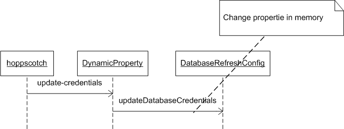
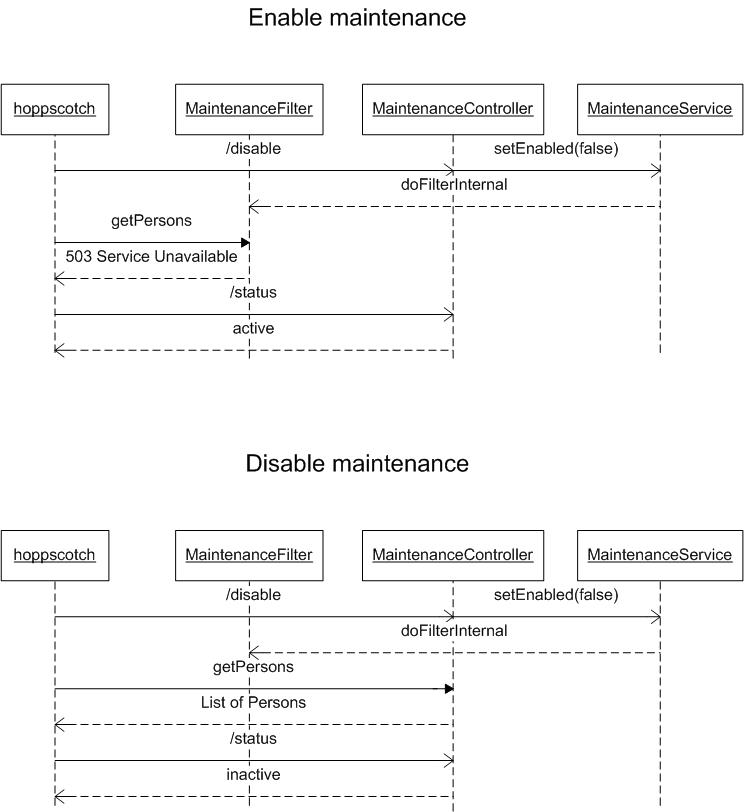

# Purpose to demonstrate dynamic datasource access
- If the datasource is disconnected, run springboot anyway.
- Restart and shutdown springboot with jvm stays alive from controller
- Dynamically updates the database credentials
- Set server in maintenance mode

## Refresh property with controller(Dynamically updates the database credentials)

## Overview


### The controller
``` java
package com.example.dynamicAccess.DynamicDatabaseAccess.controllers.propertys;

import com.example.dynamicAccess.DynamicDatabaseAccess.DynamicDatabaseAccessApplication;
import com.example.dynamicAccess.DynamicDatabaseAccess.config.DatabaseRefreshConfig;
import com.example.dynamicAccess.DynamicDatabaseAccess.dto.DatabaseProperties;
import io.swagger.v3.oas.annotations.Operation;
import io.swagger.v3.oas.annotations.media.Content;
import io.swagger.v3.oas.annotations.media.Schema;
import io.swagger.v3.oas.annotations.responses.ApiResponse;
import lombok.RequiredArgsConstructor;
import lombok.extern.log4j.Log4j2;
import org.springframework.context.ApplicationContext;
import org.springframework.core.env.Environment;
import org.springframework.http.ProblemDetail;
import org.springframework.http.ResponseEntity;
import org.springframework.web.bind.annotation.PostMapping;
import org.springframework.web.bind.annotation.RequestMapping;
import org.springframework.web.bind.annotation.RequestParam;
import org.springframework.web.bind.annotation.RestController;
import org.springframework.web.bind.annotation.GetMapping;

import java.io.IOException;


@Log4j2
@RestController
@RequiredArgsConstructor
@RequestMapping("/api/v1/DynamicProperty")
public class DynamicProperty {

    private final DatabaseRefreshConfig databaseRefreshConfig;
    private final Environment env;
    private final ApplicationContext ctx;
    private final PropertyReaderWriter propertyReaderWriter;

    private static final  String APPLICATION_PROPERTIES = "application.properties";
    private static final  String SPRING_DATASOURCE_PASSWORD = "spring.datasource.password";
    private static final  String RESPONSE_CODE_200 = "200";
    private static final  String RESPONSE_CODE_4XX = "4XX";
    private static final  String CLIENT_ERROR = "Client Error (e.g., Bad Request, Unauthorized, Not Found, Validation)";
    private static final  String INTERNAL_SERVER_ERROR = "500";
    private static final  String INTERNAL_SERVER_ERROR_STRING = "Internal Server Error";
    private static final  String UNEXPECTED_ERROR = "Unexpected Error";
    private static final  String DEFAULT = "default";


    @Operation(
            summary = "Flexible endpoint to manually set a different database user and password",
         responses = {
            @ApiResponse(
                    responseCode = RESPONSE_CODE_200,
                    description = "OK",
                    content = @io.swagger.v3.oas.annotations.media.Content(schema = @Schema(implementation = String.class)
                    )
            ),
            @ApiResponse(
                    responseCode = RESPONSE_CODE_4XX, // Catches 400, 401, 403, 404, etc.
                    description = CLIENT_ERROR,
                    content = @Content(
                            schema = @Schema(implementation = ProblemDetail.class)
                    )
            ),
            @ApiResponse(
                    responseCode = INTERNAL_SERVER_ERROR,
                    description = INTERNAL_SERVER_ERROR_STRING,
                    content = @Content(
                            schema = @Schema(
                                    implementation = ProblemDetail.class
                            )
                    )
            ),
            @ApiResponse(
                    responseCode = DEFAULT,
                    description = UNEXPECTED_ERROR,
                    content = @Content(
                            schema = @Schema(
                                    implementation = ProblemDetail.class
                            )
                    )
            )
    })
    @PostMapping("/update-credentials")
    public ResponseEntity<String> updateDatabaseCredentials(
            @RequestParam String username,
            @RequestParam String password) {
        try {
            databaseRefreshConfig.updateDatabaseCredentials(username, password);
            return ResponseEntity.ok("Successfully updated database credentials and refreshed connection pool for user: " + username);
        } catch (Exception e) {
            return ResponseEntity.internalServerError().body("Failed to update database credentials: " + e.getMessage());
        }
    }
}
```
### The configuration
``` java
package com.example.dynamicAccess.DynamicDatabaseAccess.config;

import lombok.RequiredArgsConstructor;
import org.springframework.boot.context.properties.ConfigurationProperties;
import org.springframework.boot.jdbc.autoconfigure.DataSourceProperties;
import org.springframework.cloud.context.config.annotation.RefreshScope;
import org.springframework.cloud.context.refresh.ContextRefresher;
import org.springframework.cloud.context.environment.EnvironmentChangeEvent;
import org.springframework.context.ApplicationEventPublisher;
import org.springframework.context.annotation.Bean;
import org.springframework.context.annotation.Configuration;
import org.springframework.context.annotation.Primary;
import org.springframework.core.env.ConfigurableEnvironment;
import org.springframework.core.env.MapPropertySource;
import org.springframework.core.env.MutablePropertySources;

import javax.sql.DataSource;
import java.util.HashMap;
import java.util.Map;
import java.util.Set;

@Configuration
@RequiredArgsConstructor
public class DatabaseRefreshConfig {

    private final ConfigurableEnvironment environment;
    private final ContextRefresher contextRefresher;
    private final ApplicationEventPublisher eventPublisher; // <-- Nodig om de wijziging door te geven


    /**
     * Dynamically updates the database credentials in memory, notifies the Spring
     * Environment of the change, and triggers a context refresh to restart
     * the connection pool with the new username and password.
     *
     * @param newUsername the new database username
     * @param newPassword the new database password
     */
    public void updateDatabaseCredentials(String newUsername, String newPassword) {
        Map<String, Object> dynamicProps = new HashMap<>();
        dynamicProps.put("spring.datasource.username", newUsername);
        dynamicProps.put("spring.datasource.password", newPassword);

        MutablePropertySources sources = environment.getPropertySources();
        if (sources.contains("dynamic-db-source")) {
            // Update de bestaande property source
            MapPropertySource ps = (MapPropertySource) sources.get("dynamic-db-source");
            ps.getSource().putAll(dynamicProps);
        } else {
            sources.addFirst(new MapPropertySource("dynamic-db-source", dynamicProps));
        }

        // 1. Publiceer een EnvironmentChangeEvent zodat Spring Cloud weet dat deze keys gewijzigd zijn
        eventPublisher.publishEvent(new EnvironmentChangeEvent(Set.of(
                "spring.datasource.username",
                "spring.datasource.password"
        )));

        // 2. Trigger nu pas de refresh, zodat @ConfigurationProperties en de DataSource opnieuw opbouwen
        contextRefresher.refresh();
    }
}
```

## Maintenance of the database
## Overview


### The controller
``` java
package com.example.dynamicAccess.DynamicDatabaseAccess.maintenance.controller;

import com.example.dynamicAccess.DynamicDatabaseAccess.maintenance.service.MaintenanceService;
import io.swagger.v3.oas.annotations.Operation;
import io.swagger.v3.oas.annotations.media.ArraySchema;
import io.swagger.v3.oas.annotations.media.Content;
import io.swagger.v3.oas.annotations.media.Schema;
import io.swagger.v3.oas.annotations.responses.ApiResponse;
import io.swagger.v3.oas.annotations.tags.Tag;
import lombok.RequiredArgsConstructor;
import org.springframework.http.ProblemDetail;
import org.springframework.http.ResponseEntity;
import org.springframework.web.bind.annotation.GetMapping;
import org.springframework.web.bind.annotation.PostMapping;
import org.springframework.web.bind.annotation.RequestMapping;
import org.springframework.web.bind.annotation.RestController;


@RestController
@RequestMapping("/api/v1/admin/maintenance")
@RequiredArgsConstructor
@Tag(name = "Maintenance Controller", description = "Beheer van de applicatie onderhoudsmodus")
public class MaintenanceController {

    private final MaintenanceService maintenanceService;


    @Operation(summary = "Enable maintenance ",responses = {
            @ApiResponse(
                    responseCode = "200",
                    description = "OK",
                    content = @io.swagger.v3.oas.annotations.media.Content(
                            array = @ArraySchema(schema = @Schema(implementation = String.class))
                    )
            ),
            @ApiResponse(
                    responseCode = "4XX", // Catches 400, 401, 403, 404, etc.
                    description = "Client Error (e.g., Bad Request, Unauthorized, Not Found, Validation)",
                    content = @Content(
                            schema = @Schema(implementation = ProblemDetail.class)
                    )
            ),
            @ApiResponse(
                    responseCode = "500",
                    description = "Internal Server Error",
                    content = @Content(
                            schema = @Schema(
                                    implementation = ProblemDetail.class
                            )
                    )
            ),
            @ApiResponse(
                    responseCode = "default",
                    description = "Unexpected Error",
                    content = @Content(
                            schema = @Schema(
                                    implementation = ProblemDetail.class
                            )
                    )
            )
    })
    @PostMapping("/enable")
    public ResponseEntity<String> enableMaintenance() {
        maintenanceService.setEnabled(true);
        return ResponseEntity.ok("Maintenance mode ENABLED. All traffic is now blocked.");
    }

    @Operation(summary = "Disable maintenance ",responses = {
            @ApiResponse(
                    responseCode = "200",
                    description = "OK",
                    content = @io.swagger.v3.oas.annotations.media.Content(
                            array = @ArraySchema(schema = @Schema(implementation = String.class))
                    )
            ),
            @ApiResponse(
                    responseCode = "4XX", // Catches 400, 401, 403, 404, etc.
                    description = "Client Error (e.g., Bad Request, Unauthorized, Not Found, Validation)",
                    content = @Content(
                            schema = @Schema(implementation = ProblemDetail.class)
                    )
            ),
            @ApiResponse(
                    responseCode = "500",
                    description = "Internal Server Error",
                    content = @Content(
                            schema = @Schema(
                                    implementation = ProblemDetail.class
                            )
                    )
            ),
            @ApiResponse(
                    responseCode = "default",
                    description = "Unexpected Error",
                    content = @Content(
                            schema = @Schema(
                                    implementation = ProblemDetail.class
                            )
                    )
            )
    })
    @PostMapping("/disable")
    public ResponseEntity<String> disableMaintenance() {
        maintenanceService.setEnabled(false);
        return ResponseEntity.ok("Maintenance mode DISABLED. Normal traffic resumed.");
    }


    @Operation(summary = "Status maintenance ",responses = {
            @ApiResponse(
                    responseCode = "200",
                    description = "OK",
                    content = @io.swagger.v3.oas.annotations.media.Content(
                            array = @ArraySchema(schema = @Schema(implementation = String.class))
                    )
            ),
            @ApiResponse(
                    responseCode = "4XX", // Catches 400, 401, 403, 404, etc.
                    description = "Client Error (e.g., Bad Request, Unauthorized, Not Found, Validation)",
                    content = @Content(
                            schema = @Schema(implementation = ProblemDetail.class)
                    )
            ),
            @ApiResponse(
                    responseCode = "500",
                    description = "Internal Server Error",
                    content = @Content(
                            schema = @Schema(
                                    implementation = ProblemDetail.class
                            )
                    )
            ),
            @ApiResponse(
                    responseCode = "default",
                    description = "Unexpected Error",
                    content = @Content(
                            schema = @Schema(
                                    implementation = ProblemDetail.class
                            )
                    )
            )
    })
    @GetMapping("/status")
    public ResponseEntity<String> getStatus() {
        boolean active = maintenanceService.isEnabled();
        return ResponseEntity.ok("Maintenance mode is currently: " + (active ? "ACTIVE" : "INACTIVE"));
    }
}
```

### The services
``` java
package com.example.dynamicAccess.DynamicDatabaseAccess.maintenance.service;

import org.springframework.stereotype.Service;
import java.util.concurrent.atomic.AtomicBoolean;

@Service
public class MaintenanceService {

    private final AtomicBoolean maintenanceMode = new AtomicBoolean(false);

    public boolean isEnabled() {
        return maintenanceMode.get();
    }

    public void setEnabled(boolean enabled) {
        maintenanceMode.set(enabled);
    }
}
```

### The HTTP filter
``` java
package com.example.dynamicAccess.DynamicDatabaseAccess.maintenance.filter;

import com.example.dynamicAccess.DynamicDatabaseAccess.maintenance.service.MaintenanceService;
import jakarta.servlet.FilterChain;
import jakarta.servlet.ServletException;
import jakarta.servlet.http.HttpServletRequest;
import jakarta.servlet.http.HttpServletResponse;
import lombok.RequiredArgsConstructor;
import org.springframework.http.HttpStatus;
import org.springframework.web.filter.OncePerRequestFilter;

import java.io.IOException;

@RequiredArgsConstructor
public class MaintenanceFilter extends OncePerRequestFilter {

    private final MaintenanceService maintenanceService;

    @Override
    protected void doFilterInternal(HttpServletRequest request, HttpServletResponse response, FilterChain filterChain)
            throws ServletException, IOException {

        String path = request.getRequestURI();

        // 1. Always allow health checks, actuator, and the admin maintenance toggle endpoints!
        if (
                path.startsWith("/actuator/") ||
                path.startsWith("/api/v1/admin/maintenance") ||
                path.startsWith("/swagger-ui") ||
                path.startsWith("/v3/api-docs")
        ) {
            filterChain.doFilter(request, response);
            return;
        }

        // 2. Check if maintenance mode is active
        if (maintenanceService.isEnabled()) {
            response.setStatus(HttpStatus.SERVICE_UNAVAILABLE.value());
            response.setContentType("application/json");
            response.getWriter().write("{\"error\": \"System is under maintenance. Please try again later.\"}");
            return;
        }

        // 3. Normal flow
        filterChain.doFilter(request, response);
    }
}
```

## Prevent that Hikari not startup,with broken database connection

``` properties
spring.datasource.hikari.initialization-fail-timeout=-1
```

## configuration hikari
``` properties
# Maximum number of actual active and idle connections in the pool (Default: 10)
spring.datasource.hikari.maximum-pool-size=10

# Minimum number of idle connections that HikariCP tries to maintain (Default: same as maximumPoolSize)
spring.datasource.hikari.minimum-idle=10

# Maximum time (in ms) to wait for a connection from the pool before throwing an exception (30 seconds)
spring.datasource.hikari.connection-timeout=30000

# Maximum time (in ms) a connection can sit idle in the pool before being closed (10 minutes)
spring.datasource.hikari.idle-timeout=600000

# Maximum lifetime (in ms) of a connection in the pool regardless of use (30 minutes)
spring.datasource.hikari.max-lifetime=1800000

# Threshold (in ms) to log a warning if a connection is checked out too long (0 = disabled)
spring.datasource.hikari.leak-detection-threshold=0
```

## Monitoring Hikari

### Implementation in gradle
``` groovy
// Micrometer Prometheus use for monitoring
implementation 'io.micrometer:micrometer-registry-prometheus'
```

### Settings in de properties file
``` properties
#######################################################################
# actuators
#######################################################################
# Expose health,refresh and prometheus endpoints over web
management.endpoints.web.exposure.include=health,refresh,info,prometheus

#######################################################################
# prometheus
##################################################################
management.endpoint.prometheus.enabled=true
```

### Aad file prometheus.yml

``` yml
scrape_configs:
- job_name: 'dynamic-database-access'
  metrics_path: '/actuator/prometheus'
  scrape_interval: 5s
  static_configs:
    - targets: ['localhost:8080']
```


### Links prometeus
> [Raw prometheus](http://localhost:8080/actuator/prometheus)
>
> [Prometheus UI](http://localhost:9090)

## Grafana
### Grafana UI
[Grafana UI](http://localhost:3000)
 

## Scheduler
<a href="https://stackoverflow.com/questions/35169161/scheduler-not-running-in-spring-boot">Configuring a Hikari Connection</a>


## Swagger
http://localhost:8080/swagger-ui/index.html

## actuators
http://localhost:8080/actuator/health
http://localhost:8080/actuator/info
http://localhost:8080/actuator/refresh
